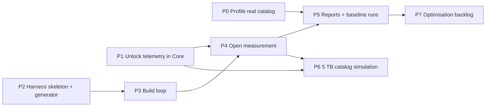

# 04: Implementation plan

## Working rules (from this user's standing instructions)

- **Pull `main` first** (`git pull` in `C:\repos\vibe\diffusiongen-gallery`), then create a **worktree** under
  `C:\repos\entityadam\copilot-worktrees\diffusiongen-gallery\<branch>`. Do not create a branch in place in the main checkout.
- All git and PR actions go through the **EntityAdam** account. Never use entityadam-ais. Never use the `create_pull_request` tool, which forks.
  Per command:
  - set `$env:GH_TOKEN = gh auth token --user EntityAdam`
  - check that `gh api user --jq .login` returns `EntityAdam`
  - push with `git -c credential.helper= -c 'credential.helper=!gh auth git-credential' push ...`
  - create PRs with `gh pr create`
- **Do not commit or push without explicit user consent.** Ask before any surprising git change.
- Build: `dotnet build src\Gallery.slnx --nologo -v q`. Test: `dotnet test src\Gallery.slnx --no-build --nologo -v q`.
  Do not use `--artifacts-path`, because the ProcessMediator copy target fails with it (MSB3030).
- PR #18 is **merged** (per the user). Pull `main` and branch from it. Line numbers in these docs refer to the pre-merge
  `5671143`, so re-locate code by symbol name.

## Phase overview

Phases P1 and P2 do not share files, so they can run as **parallel bounded subagents**. P3 and P4 share the harness project; run
them in sequence, or split them by folder (`Build/` vs. `Open/`) with `Program.cs` owned by one agent.

---

## P0: Profile the real catalog (no code in the repo)

- **Do:** a short throwaway script (Node is available; Python is not) or a `profile-catalog` command, once P2 exists. It opens the
  user's real `gallery.db` **read-only** (`Mode=ReadOnly`; no DbUp).
- **Output:** row count; p50, p95 and max of `length(record)` and `length(thumbnail)`; page stats; `drive_operations` by state.
- **Why:** calibrates `--metadata-dist`, and checks the "~180 KB per item" inference (doc 01, A10).
- **Acceptance:** numbers recorded in `results/catalog-profile.jsonl`. The user confirms nothing sensitive is in them.
- **Size:** small.

## P1: Vault-open telemetry in `Gallery.Core`

- **Owns:** `GalleryService.Lifecycle.cs`, `GalleryService.cs` (the `LoadGalleryWithKeyAsync` region only),
  `GalleryService.Storage.cs` (optional), `DataManagers/GalleryStore.cs` (`OpenAsync`, `ReadImageRecordsAsync`, `ReadThumbnailAsync`),
  `DataManagers/VaultStore.cs` (unlock region), a new internal `CatalogMetrics.cs`, and the new test file
  `src/tests/Gallery.Tests/VaultOpenTelemetryTests.cs`.
- **Spec:** doc 03.
- **Acceptance:** doc 03, "Acceptance criteria". Full test suite green.
- **Size:** medium, about 300–500 lines including tests.

## P2: Harness skeleton and PNG generator

- **Owns:** `src/perf/Gallery.Stress/**`, `src/Gallery.slnx` (add one line), and the new test
  `src/tests/Gallery.Tests/StressGeneratorTests.cs`. This test project needs a reference to `Gallery.Stress`; alternatively, put the generator in a
  small `Gallery.Stress.Core` class library referenced by both. **Prefer the latter**, because test projects referencing an Exe is awkward.
  - Revised layout: `src/perf/Gallery.Stress.Core/` (generator, size parsing, result writer, environment capture) and
    `src/perf/Gallery.Stress/` (CLI only).
- **Do:** CLI parsing; `SizeDistribution`; `SyntheticPngWriter` (doc 02, section 3); `ComfyMetadataFaker`; `ResultWriter` with environment capture;
  safety rails (doc 02, section 6); `profile-catalog`.
- **Acceptance:**
  - Generating 50 files with seed 1 produces byte-identical output on a second run.
  - Every file is within ±15% of 1 MB (`fixed:1MB`), and `tier:` sizes are within ±10% with exact dimensions.
  - All 50 SHA-256 hashes are distinct.
  - `ComfyMetadata.Extract` (through `ImportAsync` on a `TestVault`) yields a non-empty `Generation.Prompt` and `Model`.
  - `profile-catalog` on a `TestVault` catalog reports the correct row count, and never opens the database read-write. Test this by
    making the file read-only.
  - Safety rail: `build` refuses a vault path inside the repo.
- **Size:** medium.

## P3: Build loop (generate, ingest, checkpoint)

- **Owns:** `src/perf/Gallery.Stress/Build/**` and the `build` and `cleanup` command wiring.
- **Do:** doc 02, `build` steps 1–5: resumable `state.json`, disk prechecks, `DeleteAfterVerification`, and JSONL ingestion
  results. Ctrl+C handling.
- **Acceptance (smoke, run locally, not in CI):**
  - `build --targets 1k,2k --batch-files 500` completes. `ingestion.jsonl` has one row per batch, with all
    `IngestionStage` stages populated.
  - The staging folder is empty afterwards (sources were deleted after verification).
  - Kill the process mid-batch, then re-run. It resumes, the final record count equals the files generated, and there are no duplicates.
  - The vault opens in the real app (`Gallery.Web`) with the generated passphrase. This is a manual check by the user.
- **Size:** medium.

## P4: Open measurement

- **Owns:** `src/perf/Gallery.Stress/Open/**`, plus the `measure-open` and `open-once` wiring.
- **Depends on:** P1 (telemetry names), and P3 for vaults to measure. It can be developed against a `build --targets 1k` vault.
- **Do:** doc 02, `measure-open`, `open-once` and section 5 (cold cache). Use the `ActivityListener` and `MeterListener` from doc 03. Capture process I/O and GC.
- **Acceptance:**
  - `measure-open --runs 3 --cache warm` on a 1k-item vault writes 3 rows with all step timings > 0, and
    `telemetry.gallery.load.record_count` matches the catalog count.
  - `--cache cold` when not elevated records `cachePurge: "failed"` and prints a warning. When elevated, it records `"standby-list"`, and the
    cold `io.readBytes` is noticeably greater than the warm one.
  - Each run is a separate child process. Assert that the PIDs differ in the output.
- **Size:** medium.

## P5: Reports and first real runs

- **Owns:** `Results/ReportCommand.cs` and the harness `README.md`.
- **Do:** `report` (doc 02, section 2). README: prerequisites (admin for a cold cache, a Defender exclusion recommendation, disk
  space table), example commands, and `dotnet-counters` / `dotnet-trace` commands for the **real** gallery (doc 03, last section).
- **Runs (the user's machine; long):**
  1. Telemetry on the **real** 28k gallery: cold ×3 and warm ×3. This is the most important single data point.
  2. `build --targets 100k,200k,400k --measure-open-at-targets --open-runs 3 --cache both`.
  3. `large-images` (doc 02, section 7). It is short, so run it early to catch memory problems before the long build.
- **Acceptance:** `report.md` has tables per target, a step breakdown, and fitted slopes with R². Hypotheses H1–H6 are each marked
  *supported*, *rejected* or *inconclusive*, with the evidence.

## P6: Catalog simulation for 5 TB (doc 05)

- **Owns:** `src/perf/Gallery.Stress/Simulate/**` and one `InternalsVisibleTo` line in `Gallery.Core.csproj`.
- **Acceptance:** see doc 05.
- **Size:** medium.

## P7: Optimisation backlog (after data exists; not part of the harness)

Candidate changes, ranked by the expected payoff *if* the matching hypothesis is confirmed. **Do not implement any of these before P5 data
exists.**

| Candidate | Addresses | Notes |
|-----------|-----------|-------|
| Split `images` into a small encrypted **summary** blob (the fields the grid, filter and sort need) and a **detail** blob (`Metadata`, workflow and long text), loaded lazily on selection | H1, H2, H8 | Biggest structural win. Needs a migration that re-encrypts every row. Detail is read by viewer, export, duplicate and workflow features; audit them all. |
| Move `thumbnail` to its own table (`thumbnails(id PK, blob)`) | H2 | Makes the record scan read contiguous pages. A migration with `INSERT … SELECT`, then a rebuild of `images`. Pairs well with `VACUUM`. |
| Run `GalleryDatabase.Upgrade` **once per process per database path**, cache the "is current" result, and enable pooling or keep a long-lived read connection | H3 | Low risk. Watch the cross-process migration-concurrency tests (`SchemaConcurrencyTests`). |
| Batch thumbnail reads for a page into one `SELECT … WHERE id IN (…)` on one connection | H3 | Low risk. |
| Parallel decrypt and deserialise (a producer–consumer pipeline from the SQLite reader) | H1 | Moderate. Watch memory. |
| Move `BackfillGenerationAsync` into a single transaction and batch it, or out of unlock into background work | H6 | Low to moderate. |
| Delay `driveOperationPlayer.Start()` until after the first page renders | H5 | Low risk. |
| Page or virtualise in `Home.razor` instead of `List<ImageRecord>` for everything | H7, H8 | Large; it changes the UI contract. Needed for 5 TB+ if H8 holds. |
| Move the unlock and reload sequence from `Home.razor` into one `GalleryService.OpenSessionAsync()` returning a snapshot | harness drift | Lets the harness and the UI share one code path. |

Re-run P5 after each change, and compare against the stored baseline JSONL.

## Disk and time budget (estimates; confirm with P3 smoke throughput)

| Target (items) | ≈ Real media equivalent (2.4 MB) | Synthetic media (1 MB) | Catalog (~180 KB per item, to be confirmed by P0) | Free space needed (vault drive) |
|--------|-------|------|--------------|----------------------------|
| 100k | 250 GB | about 100 GB | about 18 GB | about 130 GB |
| 200k | 500 GB | about 200 GB | about 36 GB | about 250 GB |
| 400k | 1 TB | about 400 GB | about 72 GB | about 490 GB |
| Large-image suite | n/a | about 5.4 GB (plus staging) | small | about 15 GB |

Peak staging is one batch (10,000 × 1 MB ≈ 10 GB).

With `--media-directory` on another drive, split the numbers accordingly. Writing about 500 GB to an SSD consumes endurance;
mention this in the README.
